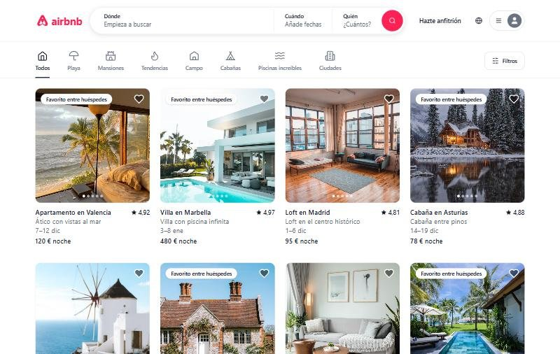
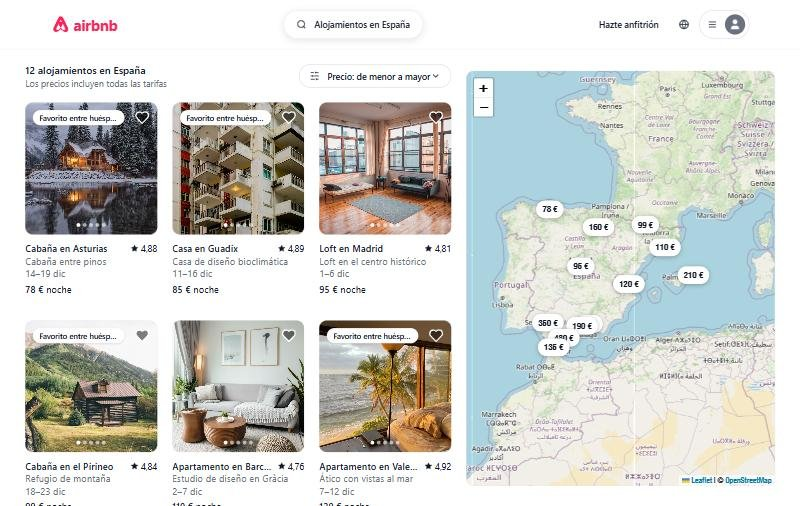
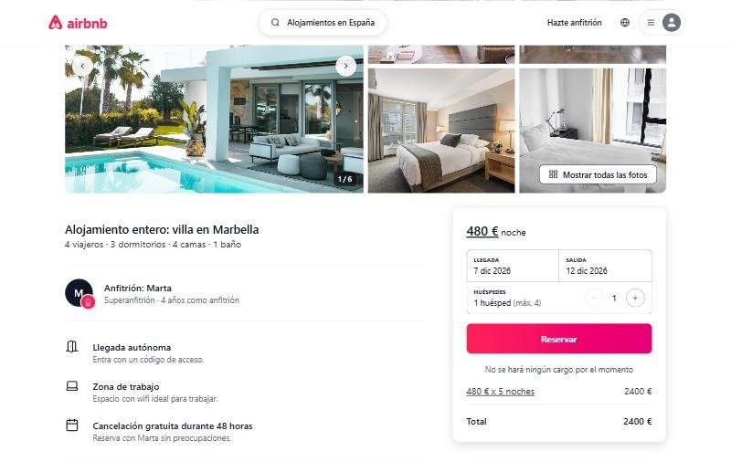
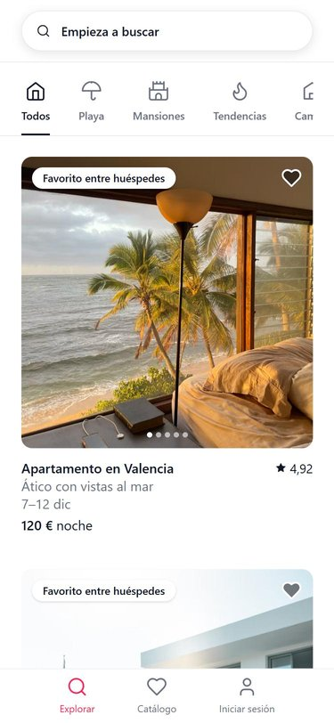
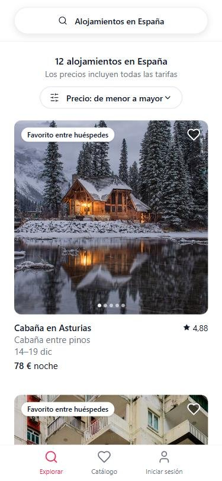
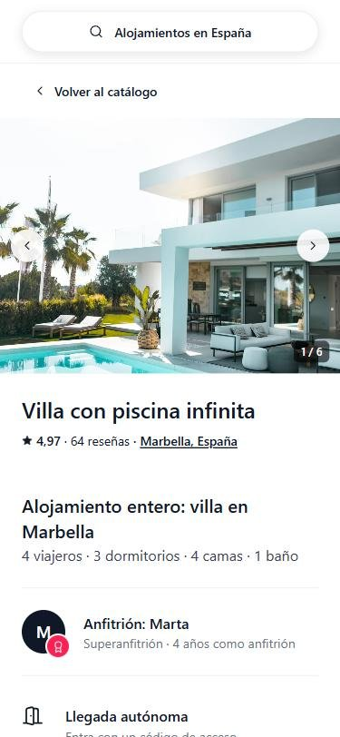

# Airbnb UI Clone

Clon de tres vistas de Airbnb (Inicio, Catálogo y Detalle de habitación) con **Next.js 16 (App Router)**, **React 19**, **TypeScript** y **Tailwind CSS 4**. Diseño *mobile-first*: pensado primero para una pantalla de 375 px y adaptado a escritorio a partir de 768 px.

**Demo en vivo:** https://rogerdevmtz.github.io/airbnb-clone

Proyecto de 4Geeks Academy · *Frontend development with Coding Agents*. El brief y las especificaciones de componentes (flujo de captura → especificación) están en [`context.md`](./context.md).

| Inicio | Catálogo | Detalle |
| --- | --- | --- |
|  |  |  |
|  |  |  |

## Funcionalidades

- **Inicio `/`:** buscador que filtra las tarjetas mientras escribes, fila de categorías con la activa resaltada, cuadrícula responsiva de tarjetas con favorito y carga simulada con *skeletons*.
- **Catálogo `/catalog`:** número de resultados, orden por precio (ascendente o descendente), la misma tarjeta que en Inicio y un mapa con un pin por alojamiento.
- **Detalle `/rooms/[id]`:** galería con Anterior / Siguiente, cabecera, anfitrión, servicios y tarjeta de reserva con el contador de huéspedes. Incluye un botón para volver al catálogo.
- **Navegación** entre las tres vistas con `<Link>`, sin recargar la página.

### Retos opcionales (completados)

- **Mapa real:** Leaflet + OpenStreetMap, con un pin de precio colocado según las coordenadas de cada alojamiento y una mini-tarjeta que enlaza al detalle.
- **Fechas y precio total:** calendario de rango con react-day-picker, en español y sin días pasados. Calcula las noches y muestra el desglose del total.

## Cómo ejecutarlo

Necesitas Node.js 20.9 o superior.

```bash
npm install
npm run dev      # http://localhost:3000
npm run build    # compilación de producción
npm run lint
```

Cada push a `main` publica la demo en GitHub Pages ([`deploy.yml`](.github/workflows/deploy.yml)): es una exportación estática generada con `GITHUB_PAGES=true`.

## Estructura

```
app/          rutas: page.tsx (/), catalog/, rooms/[id]/
components/   un componente de UI por archivo (37), cada uno con su especificación en un comentario
types/        interfaces de TypeScript: Listing, Room, Host, Amenity, Category
lib/          datos simulados, trazados de iconos y utilidades de la reserva
docs/         capturas de pantalla
.github/      despliegue automático en GitHub Pages
context.md    brief del proyecto y especificaciones de componentes
```

## Cumplimiento de la rúbrica

| Criterio | Dónde |
| --- | --- |
| `context.md` en la raíz con la interfaz, los componentes y el usuario | [`context.md`](./context.md) |
| Next.js 16 + TypeScript + Tailwind + App Router, sin plantilla de inicio | `create-next-app` · `package.json` |
| Rutas `/`, `/catalog` y `/rooms/[id]` navegables solo con `<Link>` | `app/` · `ListingCard`, `BackLink`, `MapPopupCard` |
| Mobile-first: clases base para 375 px, `md:`/`lg:` para escritorio | Todos los componentes |
| La tarjeta de alojamiento se reutiliza en Inicio y Catálogo | `ListingCard` vía `ListingGrid` |
| `useState` en 3 casos o más | Búsqueda y categoría (`app/page.tsx`), orden (`catalog`), galería (`PhotoGallery`), huéspedes y fechas (`BookingCard`), favoritos |
| `useEffect` con carga simulada y estado de carga en 2 páginas o más | `app/page.tsx`, `app/catalog/page.tsx`, `RoomView` |
| Detalle con galería, cabecera, anfitrión, servicios y reserva | `RoomDetails` |
| Un componente por archivo, una responsabilidad, menos de 80 líneas, todos `const` | `components/` (el más largo tiene 56 líneas) |
| Tipos de TypeScript para alojamiento y habitación | `types/listing.ts` |
| Solo clases de Tailwind, sin `style={{}}` ni librerías de componentes | Todo el proyecto |
| Flujo de captura → especificación documentado | `context.md` §4 y un comentario `// Spec:` en cada componente |

## Créditos

Fotos de [Unsplash](https://unsplash.com) (licencia Unsplash). Mapa de © colaboradores de [OpenStreetMap](https://www.openstreetmap.org/copyright). Iconos basados en [Lucide](https://lucide.dev) (ISC). Es un proyecto educativo sin relación con Airbnb, Inc.
